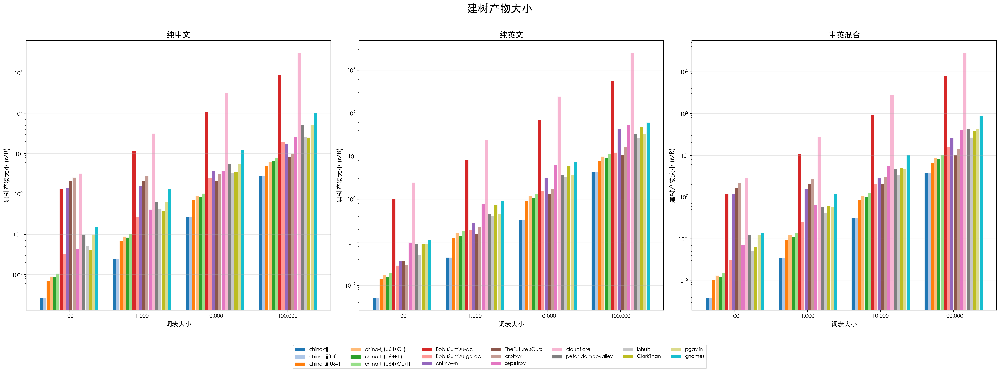
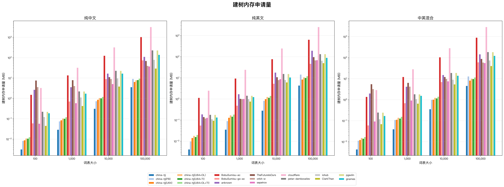
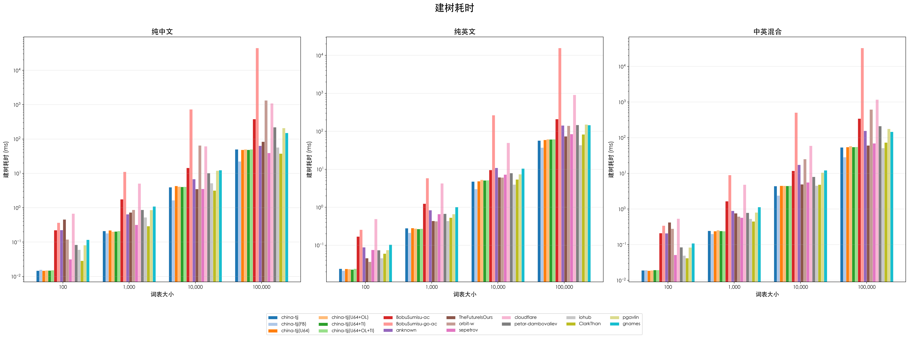
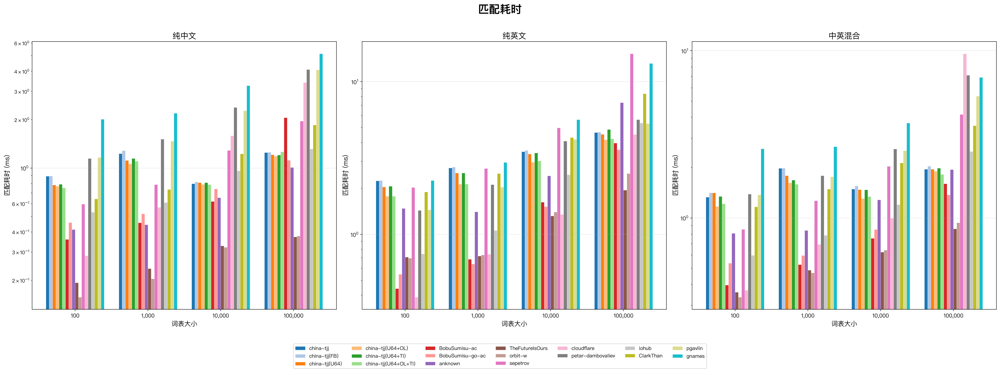

# AC 自动机 Benchmark 结果

## 简介

本项目对多个 Go 语言 Aho-Corasick（AC 自动机）开源库进行性能基准测试，对比维度包括 **建树产物大小**、**建树内存申请量**、**建树耗时**、**匹配耗时**。

### 测试数据

- **词表规模**：每组包含 100 / 1,000 / 10,000 / 100,000 个互不重复的 pattern（词条）。

- **纯中文词条**：由 `U+4E00`～`U+9FA5` 范围内的汉字生成；词长为 2～4 个汉字，其中 2 字词占 50%、3 字词占 35%、4 字词占 15%。

- **纯英文词条**：由 26 个小写英文字母生成；词长服从均值为 6、标准差为 2 的近似正态分布，并限制在 3～12 个字母之间。

- **中英混合词表**：生成每个词条时各以 50% 的概率选择中文或英文，词长规则分别沿用上述配置。

- **字符分布**：字符按齐夫分布采样，使少数字符高频、大量字符低频；中文字符多样性随词表规模增加，英文字符池固定为 26 个小写字母。所有生成结果都会去重，直到达到目标词条数量。

- **匹配文本**：每组生成约 100 KB 的同语言类型文本；生成过程中有 10% 的概率直接插入词表中的词条，以保证稳定的命中样本。随机数种子固定，确保各次 Benchmark 使用相同数据。

### 对比库

| 库 | Benchmark 名 | 实现算法 | 索引粒度 | 完整匹配结果 | 后缀链接 | 其它 |
|---|---|---|---|---|---|---|
| [china-tjj/ahocorasick](https://github.com/china-tjj/ahocorasick) | china-tjj | 标准Trie | auto | 完整 | 无 | 紧凑数据结构，自动选择最小 uint 类型 |
| 同上 | china-tjj(FB) | 标准Trie | auto | 完整 | 无 | 紧凑数据结构，自动选择最小 uint 类型，启用快速构建模式 |
| 同上 | china-tjj(U64) | 标准Trie | auto | 完整 | 无 | 紧凑数据结构，手动指定 uint64 类型 |
| 同上 | china-tjj(U64+OL) | 标准Trie | auto | 完整 | 有 | 紧凑数据结构，手动指定 uint64 类型，开启后缀链接 |
| 同上 | china-tjj(U64+TI) | 标准Trie | auto | 完整 | 无 | 紧凑数据结构，手动指定 uint64 类型，返回结果含pattern id |
| 同上 | china-tjj(U64+OL+TI) | 标准Trie | auto | 完整 | 有 | 紧凑数据结构，手动指定 uint64 类型，开启后缀链接，返回结果含pattern id |
| [BobuSumisu/aho-corasick](https://github.com/BobuSumisu/aho-corasick) | BobuSumisu-ac | 标准Trie + 预计算转移表 | byte | 完整 | 有 | 返回Match含pattern id与位置；sync.Pool复用；支持Encode/Decode(gzip) |
| [BobuSumisu/go-ahocorasick](https://github.com/BobuSumisu/go-ahocorasick) | BobuSumisu-go-ac | 双数组Trie(DAT) | byte | 完整 | 有 | SaveTrie/LoadTrie；Match结果不含pattern索引(仅pos+match bytes) |
| [anknown/ahocorasick](https://github.com/anknown/ahocorasick) | anknown | 双数组Trie(DAT) | rune | 完整 | 有 | 输出在构建时合并到output(等价后缀链效果)；Term不含pattern索引(靠Word) |
| [TheFutureIsOurs/ahocorasick](https://github.com/TheFutureIsOurs/ahocorasick) | TheFutureIsOurs | 双数组Trie(DAT) | rune | 不完整 | 有 | output压缩：同终点/后缀只保留最长term；主打低内存/低GC |
| [orbit-w/aho_corasick](https://github.com/orbit-w/aho_corasick) | orbit-w | 双数组Trie(DAT) | rune | 完整 | 有 | Trie构建时把fail节点output合并到当前节点；提供Validate/Replace等 |
| [sepetrov/ahocorasick](https://github.com/sepetrov/ahocorasick) | sepetrov | 标准Trie | rune | 完整 | 有 | 返回map[patternIndex][]pos(位置是byte offset)；含suffixLink+dictSuffixLink |
| [cloudflare/ahocorasick](https://github.com/cloudflare/ahocorasick) | cloudflare | 标准Trie | byte | 不完整 | 有 | Match返回命中过的pattern集合(去重、无位置)；有MatchThreadSafe/Contains |
| [petar-dambovaliev/aho-corasick](https://github.com/petar-dambovaliev/aho-corasick) | petar-dambovaliev | NFA/DFA | byte | 完整 | 有 | 多种MatchKind；Standard可完整/可重叠；LeftMost*会裁剪；含prefilter/Replace/迭代器 |
| [iohub/ahocorasick](https://github.com/iohub/ahocorasick) | iohub | cedar 双数组Trie | byte | 完整 | 有 | value可存任意interface{}；迭代器输出；sync.Pool复用；graphviz可视化 |
| [ClarkThan/ahocorasick](https://github.com/ClarkThan/ahocorasick) | ClarkThan | 标准Trie | rune | 完整 | 有 | SearchAppend/SearchIndexedAppend支持buf复用；输出不含pattern索引(只有Hit{Start,Len}或string) |
| [pgavlin/aho-corasick](https://github.com/pgavlin/aho-corasick) | pgavlin | NFA/DFA | byte | 完整 | 有 | 基本同petar分支；Standard可完整；LeftMost*会裁剪 |
| [gnames/aho_corasick](https://github.com/gnames/aho_corasick) | gnames | 标准Trie | byte | 不完整 | 有 | dict link实现为单跳(仅linkDict一次，不会多级追溯)，可能漏更深后缀命中；Match含pattern索引+start/end |

## 图表总览

### 建树产物大小

### 建树内存申请量

### 建树耗时

### 匹配耗时

---

## 详细数据

### 纯中文

#### 词表规模：100

| 测试库 | 建树产物大小 | 建树内存申请量 | 建树耗时 | 匹配耗时 |
|---|---|---|---|---|
| china-tjj | 2.7KB | 3.2KB | 14.1µs | 891.0µs |
| china-tjj(FB) | 2.7KB | 8.4KB | 14.8µs | 891.7µs |
| china-tjj(U64) | 7.2KB | 9.0KB | 14.5µs | 784.8µs |
| china-tjj(U64+OL) | 9.2KB | 11.0KB | 14.9µs | 770.2µs |
| china-tjj(U64+TI) | 9.0KB | 10.8KB | 14.9µs | 793.3µs |
| china-tjj(U64+OL+TI) | 11.0KB | 12.8KB | 15.1µs | 753.2µs |
| BobuSumisu-ac | 1.33MB | 1.50MB | 198.8µs | 359.8µs |
| BobuSumisu-go-ac | 32.8KB | 60.9KB | 353.6µs | 458.4µs |
| anknown | 1.42MB | 2.66MB | 210.5µs | 414.8µs |
| TheFutureIsOurs | 2.09MB | 7.57MB | 304.6µs | 193.5µs |
| orbit-w | 2.57MB | 3.60MB | 102.2µs | 157.1µs |
| sepetrov | 44.0KB | 58.8KB | 29.7µs | 596.2µs |
| cloudflare | 3.22MB | 3.26MB | 547.3µs | 284.5µs |
| petar-dambovaliev | 102.0KB | 226.7KB | 79.9µs | 1.15ms |
| iohub | 52.4KB | 125.6KB | 51.7µs | 530.7µs |
| ClarkThan | 41.3KB | 45.8KB | 25.7µs | 643.0µs |
| pgavlin | 102.0KB | 225.5KB | 74.6µs | 1.16ms |
| gnames | 157.2KB | 190.9KB | 112.7µs | 2.01ms |

#### 词表规模：1,000

| 测试库 | 建树产物大小 | 建树内存申请量 | 建树耗时 | 匹配耗时 |
|---|---|---|---|---|
| china-tjj | 25.5KB | 29.5KB | 202.6µs | 1.23ms |
| china-tjj(FB) | 25.5KB | 76.2KB | 166.5µs | 1.28ms |
| china-tjj(U64) | 70.2KB | 86.3KB | 198.9µs | 1.12ms |
| china-tjj(U64+OL) | 90.2KB | 106.3KB | 204.7µs | 1.06ms |
| china-tjj(U64+TI) | 86.2KB | 102.3KB | 205.1µs | 1.15ms |
| china-tjj(U64+OL+TI) | 106.2KB | 122.3KB | 210.9µs | 1.10ms |
| BobuSumisu-ac | 12.00MB | 13.51MB | 1.69ms | 456.4µs |
| BobuSumisu-go-ac | 280.1KB | 727.3KB | 10.72ms | 519.8µs |
| anknown | 1.58MB | 3.56MB | 641.7µs | 444.0µs |
| TheFutureIsOurs | 2.09MB | 7.89MB | 712.7µs | 236.5µs |
| orbit-w | 2.77MB | 4.07MB | 791.5µs | 204.6µs |
| sepetrov | 425.2KB | 599.1KB | 313.9µs | 788.1µs |
| cloudflare | 31.77MB | 32.12MB | 4.83ms | 569.7µs |
| petar-dambovaliev | 661.4KB | 2.21MB | 801.4µs | 1.51ms |
| iohub | 428.0KB | 1.12MB | 507.8µs | 610.1µs |
| ClarkThan | 398.5KB | 437.3KB | 273.1µs | 735.5µs |
| pgavlin | 661.4KB | 2.20MB | 813.1µs | 1.47ms |
| gnames | 1.37MB | 1.71MB | 1.09ms | 2.19ms |

#### 词表规模：10,000

| 测试库 | 建树产物大小 | 建树内存申请量 | 建树耗时 | 匹配耗时 |
|---|---|---|---|---|
| china-tjj | 277.4KB | 317.6KB | 3.86ms | 799.8µs |
| china-tjj(FB) | 277.4KB | 749.7KB | 1.68ms | 820.7µs |
| china-tjj(U64) | 720.4KB | 880.6KB | 3.89ms | 810.4µs |
| china-tjj(U64+OL) | 904.4KB | 1.04MB | 3.95ms | 790.2µs |
| china-tjj(U64+TI) | 880.4KB | 1.02MB | 3.94ms | 812.3µs |
| china-tjj(U64+OL+TI) | 1.04MB | 1.20MB | 4.02ms | 788.8µs |
| BobuSumisu-ac | 110.61MB | 125.22MB | 12.79ms | 619.7µs |
| BobuSumisu-go-ac | 2.53MB | 8.92MB | 703.28ms | 742.1µs |
| anknown | 3.76MB | 16.66MB | 5.68ms | 653.3µs |
| TheFutureIsOurs | 2.09MB | 11.20MB | 3.30ms | 328.2µs |
| orbit-w | 3.12MB | 9.05MB | 62.95ms | 320.9µs |
| sepetrov | 3.77MB | 5.11MB | 3.48ms | 1.29ms |
| cloudflare | 317.17MB | 320.84MB | 53.95ms | 1.59ms |
| petar-dambovaliev | 5.60MB | 22.75MB | 9.97ms | 2.38ms |
| iohub | 3.33MB | 9.65MB | 5.26ms | 960.8µs |
| ClarkThan | 3.54MB | 3.84MB | 3.06ms | 1.22ms |
| pgavlin | 5.60MB | 22.63MB | 9.64ms | 2.28ms |
| gnames | 12.53MB | 16.69MB | 12.23ms | 3.26ms |

#### 词表规模：100,000

| 测试库 | 建树产物大小 | 建树内存申请量 | 建树耗时 | 匹配耗时 |
|---|---|---|---|---|
| china-tjj | 2.81MB | 3.58MB | 49.42ms | 1.25ms |
| china-tjj(FB) | 2.81MB | 9.14MB | 21.35ms | 1.25ms |
| china-tjj(U64) | 4.91MB | 6.44MB | 49.48ms | 1.21ms |
| china-tjj(U64+OL) | 6.29MB | 7.82MB | 49.19ms | 1.19ms |
| china-tjj(U64+TI) | 6.44MB | 7.97MB | 48.35ms | 1.20ms |
| china-tjj(U64+OL+TI) | 7.82MB | 9.35MB | 49.14ms | 1.26ms |
| BobuSumisu-ac | 914.27MB | 1.007GB | 250.05ms | 2.06ms |
| BobuSumisu-go-ac | 19.40MB | 73.78MB | 43.612s | 1.12ms |
| anknown | 17.24MB | 110.84MB | 59.28ms | 1.01ms |
| TheFutureIsOurs | 8.19MB | 69.22MB | 79.25ms | 372.9µs |
| orbit-w | 9.83MB | 39.88MB | 1.298s | 377.7µs |
| sepetrov | 26.35MB | 36.97MB | 36.38ms | 1.96ms |
| cloudflare | 3.097GB | 3.132GB | 1.078s | 3.41ms |
| petar-dambovaliev | 50.38MB | 229.36MB | 195.58ms | 4.10ms |
| iohub | 26.60MB | 78.90MB | 55.04ms | 1.31ms |
| ClarkThan | 25.26MB | 29.39MB | 34.61ms | 1.86ms |
| pgavlin | 50.38MB | 228.20MB | 199.96ms | 4.09ms |
| gnames | 100.12MB | 138.67MB | 159.34ms | 5.15ms |

### 纯英文

#### 词表规模：100

| 测试库 | 建树产物大小 | 建树内存申请量 | 建树耗时 | 匹配耗时 |
|---|---|---|---|---|
| china-tjj | 3.7KB | 4.2KB | 19.5µs | 2.24ms |
| china-tjj(FB) | 3.7KB | 10.0KB | 20.1µs | 2.25ms |
| china-tjj(U64) | 12.7KB | 14.5KB | 19.5µs | 2.05ms |
| china-tjj(U64+OL) | 16.7KB | 18.5KB | 19.4µs | 1.78ms |
| china-tjj(U64+TI) | 14.5KB | 16.3KB | 19.4µs | 2.07ms |
| china-tjj(U64+OL+TI) | 18.5KB | 20.3KB | 20.3µs | 1.78ms |
| BobuSumisu-ac | 1.01MB | 1.13MB | 171.0µs | 441.4µs |
| BobuSumisu-go-ac | 29.5KB | 57.1KB | 254.1µs | 548.1µs |
| anknown | 38.0KB | 192.2KB | 86.8µs | 1.48ms |
| TheFutureIsOurs | 37.1KB | 142.8KB | 45.1µs | 710.1µs |
| orbit-w | 30.8KB | 123.1KB | 35.4µs | 698.6µs |
| sepetrov | 101.8KB | 130.7KB | 70.1µs | 2.03ms |
| cloudflare | 2.46MB | 2.49MB | 488.8µs | 388.1µs |
| petar-dambovaliev | 95.4KB | 182.9KB | 68.9µs | 1.44ms |
| iohub | 52.4KB | 113.1KB | 44.8µs | 746.3µs |
| ClarkThan | 93.1KB | 96.0KB | 55.2µs | 1.90ms |
| pgavlin | 95.4KB | 182.0KB | 68.4µs | 1.45ms |
| gnames | 114.0KB | 137.1KB | 101.0µs | 2.25ms |

#### 词表规模：1,000

| 测试库 | 建树产物大小 | 建树内存申请量 | 建树耗时 | 匹配耗时 |
|---|---|---|---|---|
| china-tjj | 32.2KB | 36.3KB | 238.3µs | 2.73ms |
| china-tjj(FB) | 32.2KB | 92.4KB | 195.9µs | 2.76ms |
| china-tjj(U64) | 117.0KB | 133.0KB | 231.2µs | 2.53ms |
| china-tjj(U64+OL) | 157.0KB | 173.0KB | 227.0µs | 2.13ms |
| china-tjj(U64+TI) | 133.0KB | 149.0KB | 229.5µs | 2.53ms |
| china-tjj(U64+OL+TI) | 173.0KB | 189.0KB | 249.1µs | 2.14ms |
| BobuSumisu-ac | 8.27MB | 9.31MB | 1.25ms | 687.6µs |
| BobuSumisu-go-ac | 200.1KB | 493.9KB | 5.61ms | 641.5µs |
| anknown | 293.4KB | 1.70MB | 823.5µs | 1.41ms |
| TheFutureIsOurs | 160.1KB | 1.02MB | 406.7µs | 722.2µs |
| orbit-w | 229.8KB | 1008.0KB | 375.3µs | 734.2µs |
| sepetrov | 816.0KB | 1.00MB | 632.9µs | 2.70ms |
| cloudflare | 23.84MB | 24.09MB | 4.07ms | 742.3µs |
| petar-dambovaliev | 462.7KB | 1.43MB | 629.2µs | 2.12ms |
| iohub | 428.0KB | 1005.4KB | 404.9µs | 1.06ms |
| ClarkThan | 748.5KB | 777.2KB | 531.5µs | 2.50ms |
| pgavlin | 462.7KB | 1.42MB | 641.2µs | 2.04ms |
| gnames | 955.8KB | 1.23MB | 986.9µs | 2.97ms |

#### 词表规模：10,000

| 测试库 | 建树产物大小 | 建树内存申请量 | 建树耗时 | 匹配耗时 |
|---|---|---|---|---|
| china-tjj | 248.2KB | 288.3KB | 4.24ms | 3.48ms |
| china-tjj(FB) | 248.2KB | 841.1KB | 2.76ms | 3.55ms |
| china-tjj(U64) | 848.2KB | 1008.3KB | 4.20ms | 3.37ms |
| china-tjj(U64+OL) | 1.09MB | 1.25MB | 4.33ms | 2.97ms |
| china-tjj(U64+TI) | 1008.2KB | 1.14MB | 4.29ms | 3.42ms |
| china-tjj(U64+OL+TI) | 1.25MB | 1.41MB | 4.49ms | 3.04ms |
| BobuSumisu-ac | 68.02MB | 76.54MB | 8.90ms | 1.63ms |
| BobuSumisu-go-ac | 1.55MB | 5.27MB | 251.35ms | 1.52ms |
| anknown | 3.18MB | 17.80MB | 9.83ms | 2.42ms |
| TheFutureIsOurs | 1.34MB | 10.84MB | 5.89ms | 1.32ms |
| orbit-w | 1.73MB | 7.86MB | 5.77ms | 1.40ms |
| sepetrov | 6.42MB | 8.74MB | 6.62ms | 4.99ms |
| cloudflare | 243.72MB | 246.33MB | 45.70ms | 1.35ms |
| petar-dambovaliev | 3.76MB | 15.36MB | 7.20ms | 4.08ms |
| iohub | 3.33MB | 7.99MB | 3.99ms | 2.46ms |
| ClarkThan | 5.90MB | 6.12MB | 5.14ms | 4.31ms |
| pgavlin | 3.76MB | 15.28MB | 7.07ms | 4.20ms |
| gnames | 7.47MB | 10.45MB | 10.51ms | 5.64ms |

#### 词表规模：100,000

| 测试库 | 建树产物大小 | 建树内存申请量 | 建树耗时 | 匹配耗时 |
|---|---|---|---|---|
| china-tjj | 3.55MB | 4.32MB | 52.96ms | 4.64ms |
| china-tjj(FB) | 3.55MB | 14.38MB | 34.86ms | 4.68ms |
| china-tjj(U64) | 6.83MB | 8.36MB | 52.09ms | 4.53ms |
| china-tjj(U64+OL) | 9.02MB | 10.55MB | 54.11ms | 4.17ms |
| china-tjj(U64+TI) | 8.36MB | 9.89MB | 53.04ms | 4.87ms |
| china-tjj(U64+OL+TI) | 10.55MB | 12.08MB | 54.05ms | 4.23ms |
| BobuSumisu-ac | 567.08MB | 637.44MB | 165.39ms | 3.97ms |
| BobuSumisu-go-ac | 12.33MB | 46.46MB | 16.312s | 3.58ms |
| anknown | 42.24MB | 192.23MB | 149.08ms | 7.30ms |
| TheFutureIsOurs | 10.50MB | 96.68MB | 69.53ms | 1.95ms |
| orbit-w | 16.26MB | 67.28MB | 135.19ms | 2.50ms |
| sepetrov | 51.95MB | 68.84MB | 92.35ms | 15.25ms |
| cloudflare | 2.465GB | 2.491GB | 923.44ms | 4.51ms |
| petar-dambovaliev | 33.27MB | 133.45MB | 150.29ms | 5.65ms |
| iohub | 26.60MB | 65.21MB | 42.62ms | 5.37ms |
| ClarkThan | 47.83MB | 49.77MB | 80.45ms | 8.36ms |
| pgavlin | 33.27MB | 132.59MB | 125.17ms | 5.32ms |
| gnames | 60.80MB | 89.14MB | 125.80ms | 13.17ms |

### 中英混合

#### 词表规模：100

| 测试库 | 建树产物大小 | 建树内存申请量 | 建树耗时 | 匹配耗时 |
|---|---|---|---|---|
| china-tjj | 4.0KB | 4.4KB | 17.4µs | 1.33ms |
| china-tjj(FB) | 4.0KB | 11.6KB | 18.0µs | 1.41ms |
| china-tjj(U64) | 10.7KB | 12.5KB | 17.8µs | 1.41ms |
| china-tjj(U64+OL) | 13.7KB | 15.5KB | 19.6µs | 1.17ms |
| china-tjj(U64+TI) | 12.5KB | 14.3KB | 18.2µs | 1.34ms |
| china-tjj(U64+OL+TI) | 15.5KB | 17.3KB | 18.7µs | 1.22ms |
| BobuSumisu-ac | 1.22MB | 1.37MB | 198.2µs | 397.3µs |
| BobuSumisu-go-ac | 32.0KB | 61.5KB | 324.2µs | 536.8µs |
| anknown | 1.18MB | 2.00MB | 201.2µs | 810.2µs |
| TheFutureIsOurs | 1.66MB | 5.49MB | 438.3µs | 360.2µs |
| orbit-w | 2.20MB | 3.24MB | 259.9µs | 336.0µs |
| sepetrov | 72.2KB | 95.0KB | 48.2µs | 854.4µs |
| cloudflare | 2.85MB | 2.89MB | 515.2µs | 369.4µs |
| petar-dambovaliev | 129.4KB | 252.0KB | 83.9µs | 1.39ms |
| iohub | 52.4KB | 121.4KB | 51.3µs | 597.6µs |
| ClarkThan | 66.6KB | 71.1KB | 42.3µs | 1.17ms |
| pgavlin | 129.4KB | 251.0KB | 81.9µs | 1.38ms |
| gnames | 142.6KB | 173.7KB | 112.8µs | 2.59ms |

#### 词表规模：1,000

| 测试库 | 建树产物大小 | 建树内存申请量 | 建树耗时 | 匹配耗时 |
|---|---|---|---|---|
| china-tjj | 36.2KB | 40.3KB | 250.3µs | 1.98ms |
| china-tjj(FB) | 36.2KB | 111.1KB | 199.1µs | 1.99ms |
| china-tjj(U64) | 98.2KB | 114.3KB | 245.4µs | 1.79ms |
| china-tjj(U64+OL) | 126.2KB | 142.3KB | 239.6µs | 1.62ms |
| china-tjj(U64+TI) | 114.2KB | 130.3KB | 235.9µs | 1.68ms |
| china-tjj(U64+OL+TI) | 142.2KB | 158.3KB | 240.3µs | 1.59ms |
| BobuSumisu-ac | 10.77MB | 12.12MB | 1.64ms | 526.6µs |
| BobuSumisu-go-ac | 264.1KB | 704.0KB | 8.78ms | 596.7µs |
| anknown | 1.59MB | 4.15MB | 867.4µs | 843.3µs |
| TheFutureIsOurs | 2.09MB | 6.36MB | 753.5µs | 486.9µs |
| orbit-w | 2.77MB | 4.19MB | 592.0µs | 469.2µs |
| sepetrov | 678.2KB | 948.0KB | 549.5µs | 1.27ms |
| cloudflare | 27.93MB | 28.25MB | 4.76ms | 695.5µs |
| petar-dambovaliev | 591.1KB | 1.82MB | 736.9µs | 1.79ms |
| iohub | 428.0KB | 1.07MB | 490.4µs | 787.4µs |
| ClarkThan | 626.5KB | 668.6KB | 437.6µs | 1.49ms |
| pgavlin | 591.1KB | 1.81MB | 718.3µs | 1.77ms |
| gnames | 1.22MB | 1.55MB | 1.11ms | 2.67ms |

#### 词表规模：10,000

| 测试库 | 建树产物大小 | 建树内存申请量 | 建树耗时 | 匹配耗时 |
|---|---|---|---|---|
| china-tjj | 322.9KB | 363.1KB | 4.23ms | 1.49ms |
| china-tjj(FB) | 322.9KB | 1012.1KB | 2.41ms | 1.56ms |
| china-tjj(U64) | 868.4KB | 1.00MB | 4.27ms | 1.48ms |
| china-tjj(U64+OL) | 1.08MB | 1.24MB | 4.37ms | 1.31ms |
| china-tjj(U64+TI) | 1.00MB | 1.16MB | 4.33ms | 1.47ms |
| china-tjj(U64+OL+TI) | 1.24MB | 1.40MB | 4.43ms | 1.34ms |
| BobuSumisu-ac | 92.91MB | 104.87MB | 10.97ms | 756.2µs |
| BobuSumisu-go-ac | 2.03MB | 6.98MB | 483.14ms | 853.9µs |
| anknown | 2.94MB | 15.01MB | 16.98ms | 1.29ms |
| TheFutureIsOurs | 2.09MB | 12.06MB | 4.77ms | 625.2µs |
| orbit-w | 3.11MB | 9.82MB | 24.36ms | 642.0µs |
| sepetrov | 5.45MB | 7.52MB | 5.37ms | 2.04ms |
| cloudflare | 278.34MB | 281.57MB | 53.75ms | 997.5µs |
| petar-dambovaliev | 4.66MB | 18.89MB | 8.01ms | 2.58ms |
| iohub | 3.33MB | 8.95MB | 4.40ms | 1.20ms |
| ClarkThan | 5.05MB | 5.38MB | 4.35ms | 2.13ms |
| pgavlin | 4.66MB | 18.79MB | 7.83ms | 2.53ms |
| gnames | 10.41MB | 13.93MB | 11.42ms | 3.70ms |

#### 词表规模：100,000

| 测试库 | 建树产物大小 | 建树内存申请量 | 建树耗时 | 匹配耗时 |
|---|---|---|---|---|
| china-tjj | 3.78MB | 4.54MB | 53.33ms | 1.96ms |
| china-tjj(FB) | 3.78MB | 12.80MB | 27.43ms | 2.04ms |
| china-tjj(U64) | 6.61MB | 8.14MB | 53.81ms | 1.96ms |
| china-tjj(U64+OL) | 8.48MB | 10.01MB | 54.95ms | 1.90ms |
| china-tjj(U64+TI) | 8.14MB | 9.67MB | 53.56ms | 1.99ms |
| china-tjj(U64+OL+TI) | 10.01MB | 11.54MB | 55.22ms | 1.82ms |
| BobuSumisu-ac | 788.88MB | 891.76MB | 263.13ms | 1.60ms |
| BobuSumisu-go-ac | 15.98MB | 60.00MB | 31.829s | 1.37ms |
| anknown | 26.16MB | 144.72MB | 144.91ms | 1.95ms |
| TheFutureIsOurs | 10.25MB | 87.62MB | 58.74ms | 861.6µs |
| orbit-w | 13.99MB | 59.20MB | 642.73ms | 937.5µs |
| sepetrov | 41.17MB | 55.57MB | 63.32ms | 4.16ms |
| cloudflare | 2.770GB | 2.801GB | 1.164s | 9.60ms |
| petar-dambovaliev | 43.58MB | 184.45MB | 196.35ms | 7.14ms |
| iohub | 26.60MB | 73.92MB | 92.89ms | 2.50ms |
| ClarkThan | 38.35MB | 40.36MB | 65.81ms | 3.57ms |
| pgavlin | 43.58MB | 183.45MB | 167.48ms | 5.35ms |
| gnames | 86.71MB | 122.45MB | 137.81ms | 6.94ms |
